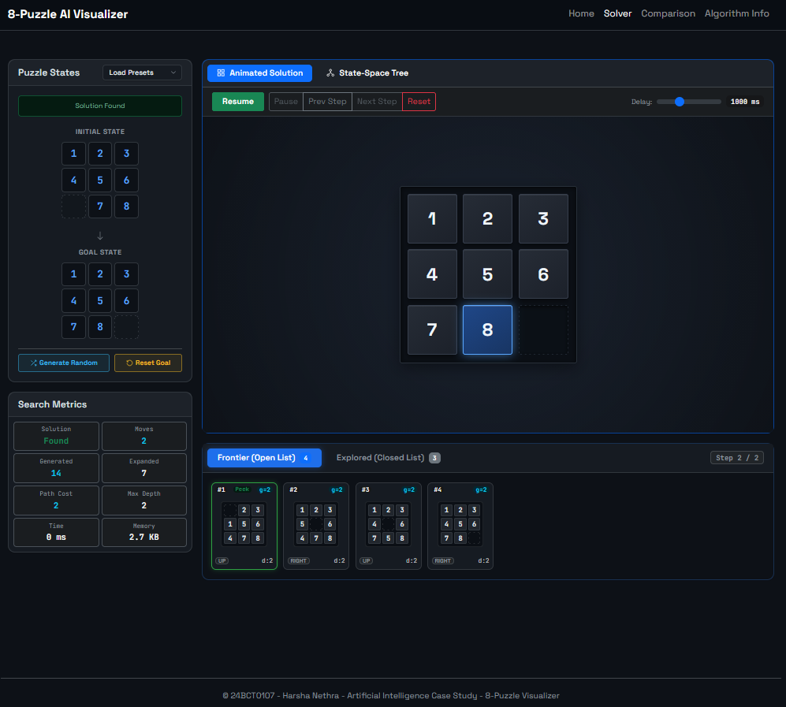
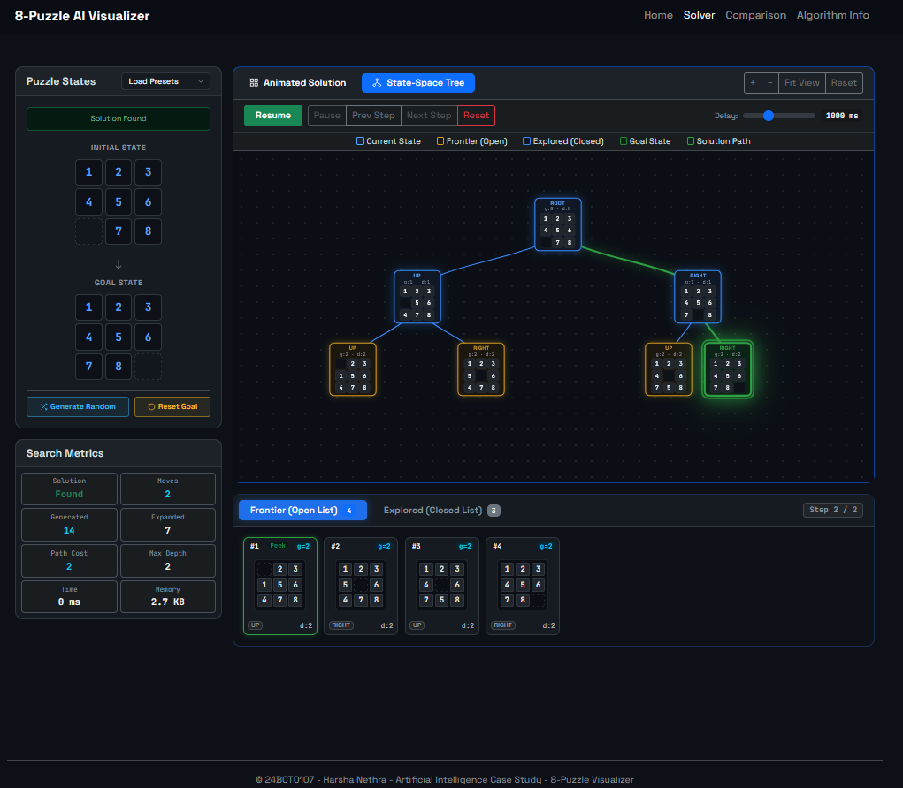
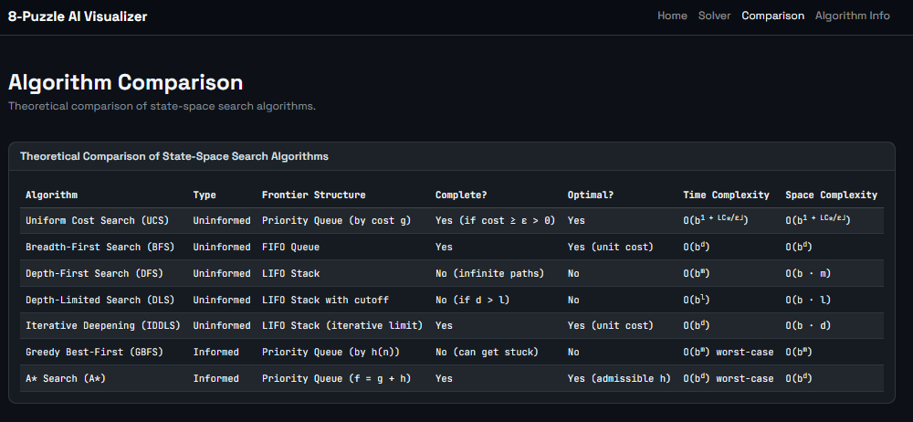

# Interactive 8-Puzzle Problem Solver Using Uniform Cost Search (UCS)

An interactive state-space search visualization web application that solves the classic 8-Puzzle Problem using **Uniform Cost Search (UCS)** from scratch in modern JavaScript.

---

## Student Details

* **Student Name:** Harsha Nethra
* **Registration Number:** 24BCT0107
* **Course:** Artificial Intelligence (Sem 5)
* **Assignment Title:** Interactive 8-Puzzle Problem Solver using AI Search Algorithms (Case Study)
* **Assigned Algorithm:** Uniform Cost Search (UCS)
* **GitHub Repository:** [https://github.com/HarshaNethra/AI-8Puzzle-Visualizer](https://github.com/HarshaNethra/AI-8Puzzle-Visualizer)
* **GitHub Pages Live URL:** [https://harshanethra.github.io/AI-8Puzzle-Visualizer/](https://harshanethra.github.io/AI-8Puzzle-Visualizer/)

---

## Project Description

The **8-Puzzle** is a classic AI benchmark problem modeled as a state-space graph:
* A 3×3 grid containing 8 numbered tiles (1 to 8) and 1 empty space (0 or blank).
* Legal actions move adjacent tiles horizontally or vertically into the empty space (Up, Down, Left, Right).
* The application allows users to configure arbitrary initial and goal states, verify solvability via mathematical inversion parity, run Uniform Cost Search (UCS), inspect real-time search metrics, and step through the solution using both an animated board and an interactive state-space tree.

---

## Technologies Used

* **HTML5:** Semantic document layout, input controls, dual-canvas layout, and accessibility attributes.
* **CSS3:** Custom responsive dark design system, CSS Grid/Flexbox, CSS custom properties (variables), hardware-accelerated tile transitions (`transform: translate`), and scroll containment (`overscroll-behavior: contain`).
* **JavaScript (ES6):**
  - Modular, decoupled architecture separating puzzle mechanics, priority queue, UCS search engine, state-space tree visualizer, rendering engine, and UI controller.
  - Custom Binary Min-Heap Priority Queue implementation for $O(\log N)$ insert and extract-min operations with deterministic FIFO tie-breaking.
  - Mathematical inversion parity counting algorithm for $O(N^2)$ solvability verification.
* **D3.js (v7):** Hardware-accelerated SVG rendering for the interactive state-space search tree, hierarchical tree layout, dynamic node sprouting, zoom/pan behaviors, and camera auto-centering.
* **UI Framework:** Bootstrap 5 (v5.3.2) for layout grid, dark theme primitives, and tab navigation.
* **Typography:** Google Fonts (`Space Grotesk` for UI and `JetBrains Mono` for aligned board arrays, metrics, and search traces).

---

## Search Algorithms Implemented

### 1. Assigned Algorithm: Uniform Cost Search (UCS)
* **Frontier Data Structure:** Binary Min-Heap keyed on cumulative path cost $g(n)$, with deterministic FIFO tie-breaking.
* **Optimality Principle:** Strict adherence to AI search theory: goal testing is performed upon **node expansion/selection** (when popped from the priority queue), never upon node generation. This mathematical property guarantees finding the globally optimal, minimum-cost path.
* **Duplicate State Elimination:** A Closed List (Explored set) paired with best-cost frontier tracking prunes redundant and dominated states.
* **Execution Trace:** Emits comprehensive step-by-step events detailing frontier snapshots, node expansion sequences, current search depth, parent pointers, and full search-tree topology for dynamic visualization.

### 2. Theoretical Comparison (All 7 Search Algorithms)
The application includes a comparative benchmarking and theoretical analysis suite comparing UCS against:
1. **Breadth-First Search (BFS):** FIFO queue, optimal for unit costs, exponential memory $O(b^d)$.
2. **Depth-First Search (DFS):** LIFO stack, linear memory $O(bm)$, incomplete and non-optimal.
3. **Depth-Limited Search (DLS):** Cutoff depth limit $l$, linear memory $O(bl)$, incomplete if $d > l$.
4. **Iterative Deepening Search (IDDLS):** Iterative cutoff depths, optimal for unit costs, linear memory $O(bd)$.
5. **Uniform Cost Search (UCS):** Min-Heap priority queue on $g(n)$, complete and globally optimal $O(b^{1 + \lfloor C^*/\epsilon \rfloor})$.
6. **Greedy Best-First Search (GBFS):** Priority queue on heuristic $h(n)$, fast but incomplete and non-optimal.
7. **A\* Search (A\*):** Priority queue on evaluation function $f(n) = g(n) + h(n)$, complete and optimal with admissible heuristics.

---

## Heuristics Used

### UCS Uninformed Property
Uniform Cost Search (UCS) is an **uninformed search algorithm**. It evaluates nodes purely by their accumulated backward path cost from the root:
$$f(n) = g(n), \quad h(n) = 0$$
Because UCS relies strictly on known transition costs without heuristic approximations, no heuristics are used in this case.

### Heuristics in Theoretical Analysis (GBFS and A*)
In accordance with course requirements, the application documents the two fundamental admissible heuristic functions used in informed search algorithms:
1. **Misplaced Tiles Heuristic ($h_1$):**
   $$h_1(n) = \sum_{i=1}^{8} [s_i \neq g_i]$$
   Counts the number of numbered tiles currently occupying a position different from their position in the goal state. Admissible because each misplaced tile must move at least once.
2. **Manhattan Distance Heuristic ($h_2$):**
   $$h_2(n) = \sum_{i=1}^{8} \left(|x_i - x_{i,\text{goal}}| + |y_i - y_{i,\text{goal}}|\right)$$
   Computes the sum of vertical and horizontal grid distances between each numbered tile's current coordinate and its goal coordinate. Admissible and strictly dominates $h_1$ ($h_2(n) \ge h_1(n)$ for all states $n$).

---

## Solvability and Mathematical Inversion Parity

An 8-puzzle board configuration is represented as an array of 9 elements containing numbers 0 through 8 (where 0 represents the blank space).

For an odd grid dimension ($N = 3$), a configuration is **solvable** if and only if the parity of its inversion count matches the goal state's inversion count. When the goal state is standard (`1 2 3 4 5 6 7 8 0`), its inversion count is 0 (even), meaning the initial state is solvable if and only if:
$$\text{Inversions}(\text{Initial State}) \pmod 2 = 0$$

An **inversion** occurs when a pair of tiles $(a, b)$ satisfies $a > b$ where tile $a$ precedes tile $b$ in the flattened grid order (excluding the blank tile 0). The engine verifies solvability before invoking UCS, preventing infinite loops or memory exhaustion on unsolvable inputs.

---

## GitHub Repository Structure

```
AI-8Puzzle-Visualizer/
│
├── index.html              # Main Single-Page Application interface
│
├── css/
│   └── style.css           # Custom dark theme, 3x3 puzzle boards, SVG tree styles, & ribbons
│
├── js/
│   ├── puzzle.js           # 8-puzzle domain engine, move validation, & inversion solvability
│   ├── priorityQueue.js    # Binary Min-Heap Priority Queue with FIFO tie-breaking
│   ├── ucs.js              # Uniform Cost Search algorithm & execution trace generator
│   ├── treeVisualizer.js   # D3.js v7 state-space search tree visualizer & camera controller
│   ├── visualizer.js       # DOM rendering engine for boards, metrics, ribbons, & tables
│   ├── controller.js       # Playback controller, step coordination, & UI event handler
│   └── app.js              # SPA router & application lifecycle bootstrap
│
├── images/                 # Repository visual documentation & screenshots
│   ├── solver-dashboard.png
│   ├── solution-path.png
│   └── algorithm-comparison.png
│
├── tests/
│   ├── test_puzzle.js      # Automated unit tests for PuzzleEngine
│   └── test_ucs.js         # Automated unit tests for PriorityQueue and UCSEngine
│
├── docs/
│   ├── PRD.md              # Product Requirements Document
│   └── IMPLEMENTATION_PLAN.md # 10-phase sequential development plan
│
└── README.md               # Project documentation
```

---

## How to Run the Project

### Running in Browser
Open `index.html` directly in any modern web browser (Google Chrome, Microsoft Edge, Mozilla Firefox, Apple Safari). No web server, node build step, or external database is required.

### Running Automated Test Suites
The project includes automated unit test suites validating mathematical inversion counting, 8-puzzle move mechanics, min-heap priority queue invariants, and UCS optimality:
```bash
# Run 8-puzzle domain unit tests
node tests/test_puzzle.js

# Run Min-Heap and UCS engine unit tests
node tests/test_ucs.js
```

---

## Interactive Controls & Features

### 1. Board Input & State Configuration
* **Interactive Tile Swapping:** Click any tile adjacent to the blank space directly on the board to manually configure states.
* **3×3 Grid Inputs:** Direct numeric input fields for both Initial State and Goal State with automatic validation.
* **Generate Random Puzzle:** Generates a random, mathematically guaranteed solvable puzzle via inversion parity checking.
* **Reset Goal State:** Instantly restores the standard goal configuration (`1 2 3 4 5 6 7 8 0`).
* **Presets:** Quick-load benchmark configurations:
  - Easy (1 Move)
  - Easy (2 Moves)
  - Medium (6 Moves)
  - Complex (14 Moves)
  - Solved (0 Moves)
  - Unsolvable (detected and flagged by inversion parity)

### 2. Playback & Execution Controls
* **Run Search:** Executes Uniform Cost Search, calculates optimal metrics, and initiates animated playback.
* **Pause / Resume:** Temporarily halts or resumes continuous solution playback.
* **Step Forward / Backward:** Step-by-step examination of the solution path (`Next Step` and `Prev Step`).
* **Reset:** Clears metrics, search tree, frontier/explored lists, and restores initial configuration.
* **Speed Slider:** Adjusts animation delay in real time from 50 ms (Fast) to 1200 ms (Slow).

### 3. Dual Visualization Modes
* **Mode A: Animated Solution (Default Tab):**
  - Hardware-accelerated sliding board with smoothly translated tile movements.
  - Step counter, move action indicator (Up, Down, Left, Right), and cumulative step cost $g(n)$.
  - Natural page scrolling enabled across the solution area.
* **Mode B: State-Space Tree (D3.js SVG Visualizer):**
  - Hierarchical tree layout rendering the search tree explored by UCS.
  - **Dynamic Sprouting:** Tree nodes emerge dynamically as search/playback steps advance (starting with only the root at Step 0).
  - **Camera Auto-Glide:** Smooth zoom-to-fit tracking focusing on the active node.
  - **Color Hierarchy:**
    - Standard Tree Edges: Cool Blue (`#388bfd`)
    - Solution Path Edges: Emerald Green (`#2ea043`)
    - Goal State Node: Emerald Green (`#2ea043`)
    - Explored Path Nodes: Cool Blue (`#388bfd`)
    - Frontier Candidate Nodes: Amber/Orange (`#d29922`)
    - Currently Expanding Node: Glowing Cyan ring (`#00d2ff`)
  - Full pan/zoom controls and Reset View button.
  - Isolated wheel scrolling (`overscroll-behavior: contain`) preventing page chaining while zooming/panning.

### 4. Live Frontier & Explored List Switcher
Positioned directly under the main visualization canvas:
* **Dynamic Tab Switcher:** Toggle between **Frontier (Open List)** and **Explored (Closed List)**.
* **Compact Horizontal 3×3 Mini-Boards:**
  - Displays the first 10 states as compact 3×3 visual boards.
  - Rank badge, cost $g(n)$, action, and parent state details.
  - Special **Peek** badge with glowing green border highlighting the minimum-cost node at the head of the priority queue.
* **Expandable Table View:** When more than 10 states exist, a `+X more states` card appears. Clicking it toggles into a detailed tabular view with sticky headers, with a `Switch to 3×3 Grid` button to return.
* **Mouse-Wheel Horizontal Scrolling:** Hovering over the mini-board ribbon and scrolling the mouse wheel automatically scrolls horizontally.
* **Scroll Isolation:** Container wheel scrolling is isolated (`overscroll-behavior: contain`), ensuring smooth scrolling without triggering unintended parent page movement.

### 5. Search Metrics Dashboard (2×4 KPI Grid)
1. **Solution:** Status badge (`Found` in green, `Not Found` in red, `—` when idle).
2. **Moves:** Number of optimal moves in the solution path (`—` when idle or no solution).
3. **Nodes Generated:** Total states produced and evaluated into memory.
4. **Nodes Expanded:** Total states dequeued and expanded from the priority queue.
5. **Path Cost:** Cumulative optimal path cost $g(n)$.
6. **Max Search Depth:** Deepest depth level reached in the search tree.
7. **Execution Time:** High-resolution search duration in milliseconds ($O(\text{ms})$ precision).
8. **Memory Usage:** Estimated memory footprint of Frontier and Explored sets.

### 6. Solution Path Showcase
* Visual sequence of compact 3×3 boards showing every step from initial state to goal state.
* Step number, move action badge, cumulative cost $g(n)$, and jump-to-step click interaction.

---

## Screenshots

### 1. Interactive Solver Dashboard & Real-Time Search Metrics

*Interactive 3×3 input grids, hardware-accelerated sliding board, 2×4 KPI metrics grid, and frontier/explored inspector.*

### 2. State Space Tree and Solution Path

*Optimal solution path rendered as an interactive sequence of nodes with full state space tree visualization.*

### 3. Algorithm Comparison Theory

*Theoretical comparison table across all 7 AI search algorithms.*

---

## Third Party Acknowledgements and References

1. Russell, S., & Norvig, P. (2020). *Artificial Intelligence: A Modern Approach* (4th ed.). Pearson. (State-space graph search formulations and Uniform Cost Search optimality theorems).
2. Johnson, W. W., & Story, W. E. (1879). *Notes on the "15" Puzzle*. American Journal of Mathematics, 2(4), 397-404. (Mathematical inversion parity theorems for grid solvability validation).
3. D3.js (v7): Data-Driven Documents JavaScript library for dynamic SVG tree visualization. Distributed under the ISC License.
4. Bootstrap 5 (v5.3.2): Front-end toolkit for responsive layout and UI components. Distributed under the MIT License.
5. Google Fonts (`Space Grotesk` & `JetBrains Mono`): Distributed under the SIL Open Font License.
6. YouTube: [UCS Search Algorithm in Artificial Intelligence](https://youtu.be/8ofimg8cnRE?si=_M8Q1ejMdGyt-AuB)
7. GeeksForGeeks: [Uninformed Search Algorithms in AI](https://www.geeksforgeeks.org/artificial-intelligence/uniformed-search-algorithms-in-ai/)
8. GeeksForGeeks: [Informed Search Algorithms in AI](https://www.geeksforgeeks.org/artificial-intelligence/informed-search-algorithms-in-artificial-intelligence/)
